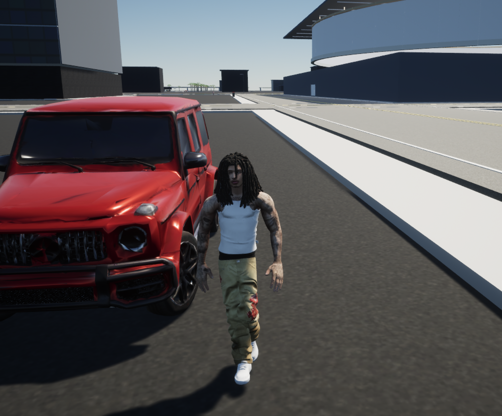
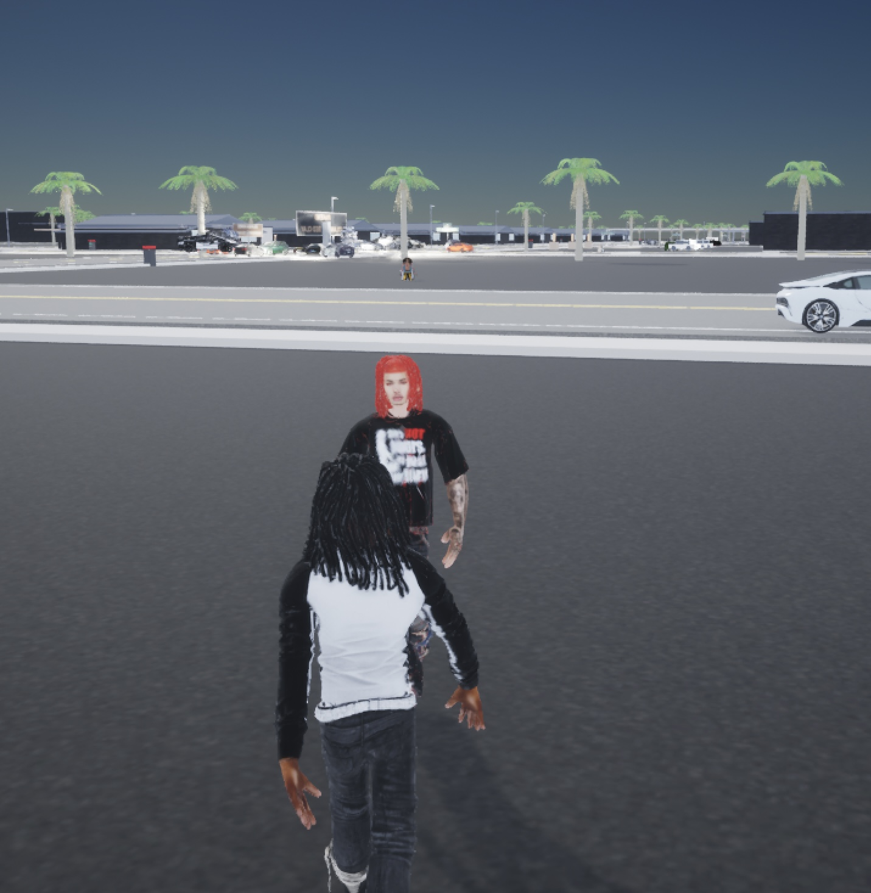

# Red Clay

### An open-world game by Ave Studios

Explore Jolanda, build relationships, pursue a career, and shape your character's place in the city.

**Unreal Engine 5.6 · C++ · iOS · Python · PostgreSQL**



*Actual development-build gameplay. This repository is a portfolio showcase, not the game's source code or a playable download.*

## Project Overview

Red Clay brings city exploration, driving, social relationships, sports, and music careers into a mobile open-world experience. The project combines real-time gameplay with persistent player profiles, account-linked progress, and verified in-app purchases.

**Status:** In development. iOS builds are distributed through TestFlight; public App Store release is pending. Android development is underway. Console versions are future plans, not currently released products.

**Creator:** [sheneria](https://github.com/sheneria) · **Studio:** Ave Studios

## Gameplay Systems

| Area | Implemented systems |
| --- | --- |
| City life | Character selection, NPC relationships, dialogue, crews, inventory, and an in-game phone |
| Vehicles | Driving controls, first- and third-person views, headlights, and radio |
| Sports careers | Basketball, football, soccer, and boxing with practice and arena progression |
| Music career | Recording-studio sessions, local song import, radio, and arena performances |
| Police career | Duty progression, arrest interactions, and prison gameplay |
| Player progression | Funds, respect, character ownership, offline autosaves, and account-linked cloud progress |



## Engineering Highlights

- **Context-sensitive mobile UI:** Touch menus and action controls adapt to on-foot, vehicle, and sports gameplay.
- **Persistence:** Offline checkpoints support recovery after interrupted sessions. Signed-in players can synchronize progress and restore it on another supported device.
- **Commerce:** Six purchase products cover Funds and randomized character packs. Server-side verification and transaction handling prevent repeat delivery; character packs draw from unowned characters.
- **Account lifecycle:** Sign-in, registration, cloud progress, and confirmed account deletion are integrated into the player experience.
- **Environment separation:** Test purchases and live purchases use separate backend records.
- **Mobile stability work:** Character-preview cleanup, targeted regression tests, and device feedback guide iteration on menus, cameras, and gameplay.

## Technical Stack

| Layer | Technologies |
| --- | --- |
| Game client | Unreal Engine 5.6, C++, native iOS integration, touch input |
| Apple distribution | Xcode signing, App Store Connect, TestFlight |
| Purchase flow | Apple in-app purchases with server-side transaction verification |
| Backend | Python service deployed on Render |
| Accounts and storage | Supabase Auth and PostgreSQL |
| Verification | Targeted Unreal automation, rendered UI checks, and physical-device testing |

### System Outline

```text
Game client
  |-- Gameplay, touch controls, and offline saves
  |-- Account authentication
  |-- Cloud progress synchronization
  `-- Apple purchase flow
          `-- Authenticated backend verification
                  |-- Purchase delivery records
                  |-- Funds and character ownership
                  `-- Separate test and live data
```

## Testing and Release Work

Development includes automated checks for mobile menu interaction, vehicle controls and camera framing, inventory access, radio behavior, and character-preview cleanup. Eighteen targeted regression tests passed for the October 2026 revision.

Device testing has also covered purchase cancellation, exact Funds delivery, all three character-pack sizes, persistence after restart, cross-device cloud restoration, and account deletion. Each new build still requires device validation; these checks are not a claim that the game is bug-free or approved for public release.

## Portfolio Summary

**Red Clay | Ave Studios | Unreal Engine 5 / C++ / Mobile**

An end-to-end game development project spanning open-world gameplay, mobile interaction design, persistent accounts, verified purchases, cloud progress, and iOS release preparation.

Areas demonstrated: gameplay systems, mobile UI iteration, backend integration, data persistence, regression testing, and release engineering.

## Contact and Rights

Project inquiries: [avestudiosofficial@gmail.com](mailto:avestudiosofficial@gmail.com)

This repository contains portfolio documentation and gameplay images only. It does not grant a license to redistribute the game, music, character assets, or other third-party material. Game source, backend implementation, credentials, signing files, and player data are not included.
